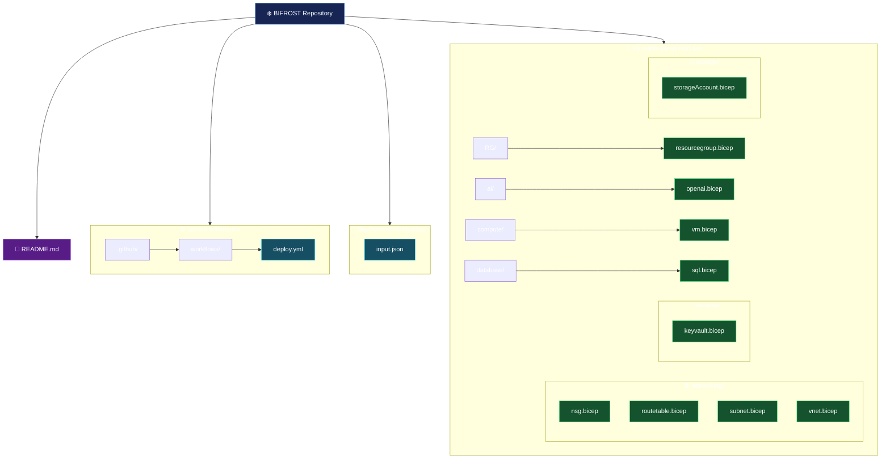
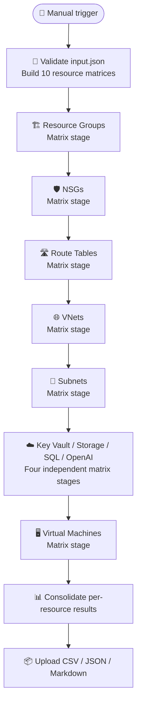

# ❄️ BIFROST — PikeHex Cloud Migration

> **Reusable Azure Bicep modules and GitHub Actions deployment workflow**

BIFROST provisions Azure infrastructure from a JSON configuration file. The repository contains reusable Bicep modules for resource groups, networking, compute, security, storage, databases, and Azure OpenAI.

## 📌 Repository overview

| Area | Description |
|---|---|
| Infrastructure as Code | Modular Azure Bicep templates under `modules/` |
| Deployment input | `input.json` — environment and landing-zone resource configuration |
| CI/CD | `.github/workflows/deploy.yml` — manually triggered GitHub Actions workflow |
| Target environment | `dev` |
| Deployment scope | Subscription scope for resource groups; resource-group scope for the other modules |
| Authentication | Azure login using OpenID Connect (OIDC) |

## 🗂️ Repository structure

The diagram below reflects the files currently present in the `main` branch.



### 📁 Module catalogue

| Module path | Responsibility |
|---|---|
| `modules/RG/resourcegroup.bicep` | Creates resource groups at subscription scope |
| `modules/networking/nsg.bicep` | Creates network security groups and security rules |
| `modules/networking/routetable.bicep` | Creates route tables and routes |
| `modules/networking/vnet.bicep` | Creates virtual networks |
| `modules/networking/subnet.bicep` | Creates subnets and associates NSGs/route tables |
| `modules/compute/vm.bicep` | Creates a Windows VM and its network interface |
| `modules/security/keyvault.bicep` | Creates Azure Key Vault |
| `modules/storage/storageAccount.bicep` | Creates storage accounts, blob service, and containers |
| `modules/database/sql.bicep` | Creates Azure SQL logical servers and databases |
| `modules/ai/openai.bicep` | Creates Azure OpenAI accounts |

## 🔄 CI/CD workflow

The workflow in `.github/workflows/deploy.yml` is manually triggered with `workflow_dispatch`. It reads `input.json`, validates the configuration, dynamically builds a separate GitHub Actions matrix for each resource type, and deploys only the objects present in the corresponding arrays.



### 🧭 Matrix stages and dependencies

| Stage | Matrix source in `input.json` | Dependency |
|---|---|---|
| Resource Groups | `landingZones.resourceGroups` | None; subscription-scope deployment |
| NSGs | `landingZones.nsgs` | Resource Groups |
| Route Tables | `landingZones.routeTables` | NSGs stage |
| VNets | `landingZones.vnets` | Route Tables stage |
| Subnets | `landingZones.subnets` | VNets; configured NSG and Route Table must exist |
| Key Vaults | `landingZones.keyVaults` | Subnets stage / resource group availability |
| Storage Accounts | `landingZones.storageAccounts` | Subnets stage / resource group availability |
| SQL Databases | `landingZones.sqlDatabases` | Subnets stage / resource group availability |
| Azure OpenAI | `landingZones.openAiServices` | Subnets stage / resource group availability |
| Virtual Machines | `landingZones.vms` | Service stages; resource group, VNet and subnet must exist |

Each resource type has its own job and matrix. If an array contains multiple objects, GitHub Actions creates one matrix job instance per object. Empty arrays receive a no-op placeholder because GitHub Actions does not accept a zero-entry matrix; the placeholder does not deploy anything.

Every matrix uses `fail-fast: false`. A failed resource does not cancel other instances in its stage. The Key Vault, Storage, SQL and OpenAI stages can run concurrently after the subnet stage. VM deployment starts after those stages and checks its actual network prerequisites before deployment.

Each matrix instance runs on a fresh `ubuntu-latest` runner, installs Azure CLI, and authenticates independently using `azure/login@v2` with OIDC. Azure login sessions are not shared between jobs.

### ⚙️ Workflow jobs

| Job | Purpose |
|---|---|
| `prepare` | Validates `input.json`, checks required secrets, and emits dynamic matrices from the requested resource arrays. |
| `deploy-resource-groups` | Deploys each requested resource group. |
| `deploy-nsgs` | Deploys each requested NSG. |
| `deploy-route-tables` | Deploys each requested route table. |
| `deploy-vnets` | Deploys each requested VNet. |
| `deploy-subnets` | Deploys each requested subnet after checking its configured dependencies. |
| `deploy-key-vaults` | Deploys each requested Key Vault. |
| `deploy-storage-accounts` | Deploys each requested storage account. |
| `deploy-sql-databases` | Deploys each requested SQL database. |
| `deploy-openai-services` | Deploys each requested Azure OpenAI account. |
| `deploy-vms` | Deploys each requested VM after checking its VNet and subnet. |
| `report` | Downloads per-resource results, fills in missing results as `SKIPPED`, and publishes the consolidated report. |

All deployment steps run What-If before create. Per-resource result files are uploaded with unique artifact names so parallel matrix results do not overwrite one another. The final report job runs even when deployment jobs fail.

## 📊 Fault-tolerant deployment report

The workflow creates a `bifrost-deployment-report` artifact after each run. It contains:

- `deployment-report.csv` — filterable resource-by-resource status report.
- `deployment-report.json` — structured report for automation and downstream processing.
- `deployment-report.md` — readable summary and detailed resource table.

Each requested resource is recorded as one of:

| Status | Meaning |
|---|---|
| `DEPLOYED` | What-If and deployment completed successfully. |
| `FAILED` | The deployment was attempted but Azure/Bicep returned an error. |
| `SKIPPED` | A prerequisite, validation, authentication, or other condition prevented the attempt. The report includes the reason. |

The workflow attempts independent resources even when another resource fails. Subnets require their VNet and any configured NSG/route table; VMs require their resource group, VNet and subnet. Dependent resources are marked `SKIPPED` when prerequisites are unavailable. Resource groups are deployed first; networking and service resources are then attempted in dependency-aware order.

The report is uploaded even when deployment fails. The workflow is marked failed at the end if any resource failed or was skipped, so the run remains visibly unsuccessful without aborting the remaining resource attempts. The artifact is retained for 90 days.

To download it, open the completed GitHub Actions run and download the `bifrost-deployment-report` artifact.

## 📝 Configuration — `input.json`

The root-level `input.json` is the workflow's deployment feed. It currently defines:

- Root environment and request metadata.
- Subscription metadata, with the subscription ID supplied through the `AZURE_SUBSCRIPTION_ID` secret at runtime.
- Deployment location.
- `landingZones` arrays for resource groups, VNets, subnets, NSGs, route tables, VMs, Key Vaults, storage accounts, SQL databases, and Azure OpenAI services.

To request additional instances, add objects to the appropriate array and ensure resource references (for example, VM-to-subnet and subnet-to-NSG/route-table) point to the intended resources.

## 🔐 GitHub Actions secrets and identity

Configure the following secrets for the repository or the `dev` environment:

| Secret | Purpose |
|---|---|
| `AZURE_CLIENT_ID` | Microsoft Entra application/service principal client ID |
| `AZURE_TENANT_ID` | Microsoft Entra tenant ID |
| `AZURE_SUBSCRIPTION_ID` | Azure subscription GUID |
| `VM_ADMIN_PASSWORD` | Windows VM local administrator password |
| `SQL_ADMIN_PASSWORD` | SQL administrator password |

The workflow uses `azure/login@v2` with OIDC. Configure a federated credential in Microsoft Entra ID whose subject matches the GitHub repository/environment context. Do not store credentials or passwords in `input.json` or commit them to the repository.

## 🧰 Local Bicep validation

Run from the repository root after installing Azure CLI and Bicep:

```powershell
$ErrorActionPreference = 'Stop'

az version
az bicep version

$files = Get-ChildItem modules -Recurse -Filter '*.bicep'
if ($files.Count -eq 0) {
    throw 'No Bicep modules found.'
}

foreach ($file in $files) {
    Write-Host "Building $($file.FullName)"
    az bicep build --file $file.FullName --stdout | Out-Null
    if ($LASTEXITCODE -ne 0) {
        throw "Bicep build failed: $($file.FullName)"
    }
}
```

## 🛡️ Deployment safety notes

1. Review the What-If output before approving infrastructure changes.
2. Confirm resource names are valid and globally available where Azure requires uniqueness.
3. Confirm the target subscription, resource groups, region, SKUs, and expected costs.
4. Keep VM and SQL administrator passwords in GitHub Actions secrets.
5. Review network access settings before deployment. The sample configuration includes private SQL network access and a VM without a public IP.
6. Treat changes to existing VNets and subnets carefully; the VNet job intentionally skips an existing VNet to avoid replacing its subnet configuration.

## 📚 Current repository scope

The `main` branch currently contains only the files and folders represented in the repository tree above. In particular, there is no `modules/main.bicep`, `environments/` directory, or `config/subscriptions.json` in this branch. The deployment workflow uses the root `input.json` and invokes the individual Bicep modules directly.

---

<p align="center">
  ❄️ **BIFROST | Infrastructure as Code | Azure | Bicep | GitHub Actions** 🚀
</p>
