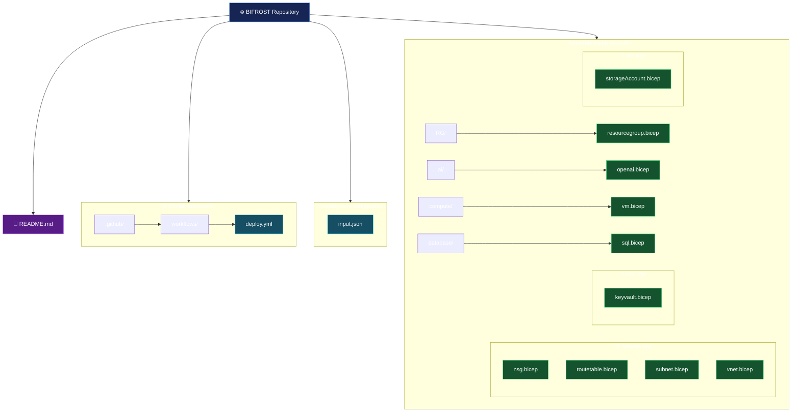
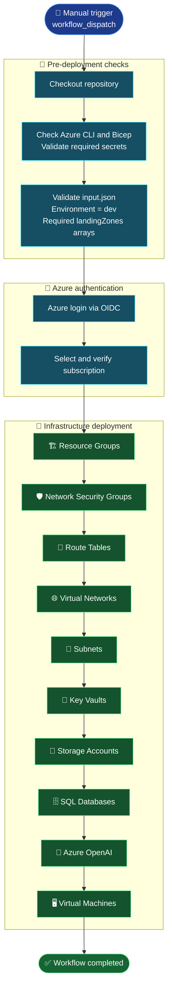
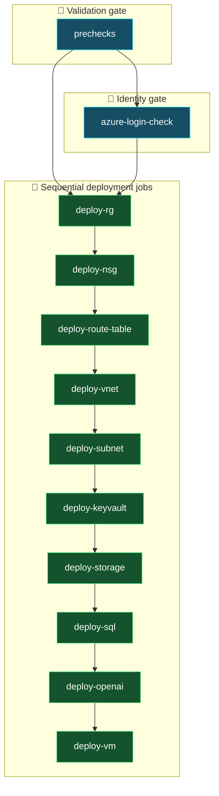

# ❄️ BIFROST — PikeHex Cloud Migration

> **Reusable Azure Bicep modules and GitHub Actions deployment workflow**

BIFROST provisions Azure infrastructure from a JSON configuration file. The repository contains reusable Bicep modules for resource groups, networking, compute, security, storage, databases, and Azure OpenAI.

## 📌 Repository overview

| Area | Description |
|---|---|
| Infrastructure as Code | Modular Azure Bicep templates under `modules/` |
| Deployment input | `input.json` — environment and landing-zone resource configuration |
| CI/CD | `.github/workflows/deploy.yml` — manually triggered GitHub Actions workflow |
| Target environment | `dev` |
| Deployment scope | Subscription scope for resource groups; resource-group scope for the other modules |
| Authentication | Azure login using OpenID Connect (OIDC) |

## 🗂️ Repository structure

The diagram below reflects the files currently present in the `main` branch.



### 📁 Module catalogue

| Module path | Responsibility |
|---|---|
| `modules/RG/resourcegroup.bicep` | Creates resource groups at subscription scope |
| `modules/networking/nsg.bicep` | Creates network security groups and security rules |
| `modules/networking/routetable.bicep` | Creates route tables and routes |
| `modules/networking/vnet.bicep` | Creates virtual networks |
| `modules/networking/subnet.bicep` | Creates subnets and associates NSGs/route tables |
| `modules/compute/vm.bicep` | Creates a Windows VM and its network interface |
| `modules/security/keyvault.bicep` | Creates Azure Key Vault |
| `modules/storage/storageAccount.bicep` | Creates storage accounts, blob service, and containers |
| `modules/database/sql.bicep` | Creates Azure SQL logical servers and databases |
| `modules/ai/openai.bicep` | Creates Azure OpenAI accounts |

## 🔄 CI/CD workflow

The workflow is defined in `.github/workflows/deploy.yml` and is triggered manually using `workflow_dispatch`. It reads `input.json`, validates the requested dev configuration, authenticates to Azure with OIDC, and deploys resources in dependency order.



### 🧭 Job dependency map

Each deployment job waits for its prerequisite job. A failure in a required job prevents dependent jobs from proceeding.



### ⚙️ Workflow execution details

| Stage | Job | Runner | Main activity |
|---|---|---|---|
| 1 | `prechecks` | `ubuntu-latest` | Checks CLI/Bicep and required secrets; validates `input.json` |
| 2 | `azure-login-check` | Windows self-hosted | Azure OIDC login and subscription verification |
| 3 | `deploy-rg` | Windows self-hosted | Subscription-scope resource-group What-If and deployment |
| 4 | `deploy-nsg` | Windows self-hosted | NSG What-If and deployment |
| 5 | `deploy-route-table` | Windows self-hosted | Route-table What-If and deployment |
| 6 | `deploy-vnet` | Windows self-hosted | VNet What-If and deployment; skips an existing VNet |
| 7 | `deploy-subnet` | Windows self-hosted | Subnet What-If and deployment |
| 8 | `deploy-keyvault` | Windows self-hosted | Key Vault What-If and deployment |
| 9 | `deploy-storage` | Windows self-hosted | Storage account and container deployment |
| 10 | `deploy-sql` | Windows self-hosted | SQL server and database deployment |
| 11 | `deploy-openai` | Windows self-hosted | Azure OpenAI What-If and deployment |
| 12 | `deploy-vm` | Windows self-hosted | Windows VM and NIC What-If and deployment |

The resource deployment jobs generate temporary ARM parameter JSON files from the corresponding objects in `input.json`. They run an Azure deployment `what-if` before the deployment command.

> ⚠️ **Current workflow configuration to review:** the `prechecks` job runs on `ubuntu-latest`, but its PowerShell step checks for Azure CLI at a Windows-specific path (`C:\Program Files\Microsoft SDKs\Azure\CLI2\wbin\az.cmd`). That path is not normally present on an Ubuntu runner. Align the runner and CLI invocation before relying on this precheck.

The final Azure resource verification job is currently commented out in `deploy.yml`; it is not an active workflow job.

## 📝 Configuration — `input.json`

The root-level `input.json` is the workflow's deployment feed. It currently defines:

- Root environment and request metadata.
- Subscription metadata, with the subscription ID supplied through the `AZURE_SUBSCRIPTION_ID` secret at runtime.
- Deployment location.
- `landingZones` arrays for resource groups, VNets, subnets, NSGs, route tables, VMs, Key Vaults, storage accounts, SQL databases, and Azure OpenAI services.

To request additional instances, add objects to the appropriate array and ensure resource references (for example, VM-to-subnet and subnet-to-NSG/route-table) point to the intended resources.

## 🔐 GitHub Actions secrets and identity

Configure the following secrets for the repository or the `dev` environment:

| Secret | Purpose |
|---|---|
| `AZURE_CLIENT_ID` | Microsoft Entra application/service principal client ID |
| `AZURE_TENANT_ID` | Microsoft Entra tenant ID |
| `AZURE_SUBSCRIPTION_ID` | Azure subscription GUID |
| `VM_ADMIN_PASSWORD` | Windows VM local administrator password |
| `SQL_ADMIN_PASSWORD` | SQL administrator password |

The workflow uses `azure/login@v2` with OIDC. Configure a federated credential in Microsoft Entra ID whose subject matches the GitHub repository/environment context. Do not store credentials or passwords in `input.json` or commit them to the repository.

## 🧰 Local Bicep validation

Run from the repository root after installing Azure CLI and Bicep:

```powershell
$ErrorActionPreference = 'Stop'

az version
az bicep version

$files = Get-ChildItem modules -Recurse -Filter '*.bicep'
if ($files.Count -eq 0) {
    throw 'No Bicep modules found.'
}

foreach ($file in $files) {
    Write-Host "Building $($file.FullName)"
    az bicep build --file $file.FullName --stdout | Out-Null
    if ($LASTEXITCODE -ne 0) {
        throw "Bicep build failed: $($file.FullName)"
    }
}
```

## 🛡️ Deployment safety notes

1. Review the What-If output before approving infrastructure changes.
2. Confirm resource names are valid and globally available where Azure requires uniqueness.
3. Confirm the target subscription, resource groups, region, SKUs, and expected costs.
4. Keep VM and SQL administrator passwords in GitHub Actions secrets.
5. Review network access settings before deployment. The sample configuration includes private SQL network access and a VM without a public IP.
6. Treat changes to existing VNets and subnets carefully; the VNet job intentionally skips an existing VNet to avoid replacing its subnet configuration.

## 📚 Current repository scope

The `main` branch currently contains only the files and folders represented in the repository tree above. In particular, there is no `modules/main.bicep`, `environments/` directory, or `config/subscriptions.json` in this branch. The deployment workflow uses the root `input.json` and invokes the individual Bicep modules directly.

---

<p align="center">
  ❄️ **BIFROST | Infrastructure as Code | Azure | Bicep | GitHub Actions** 🚀
</p>
