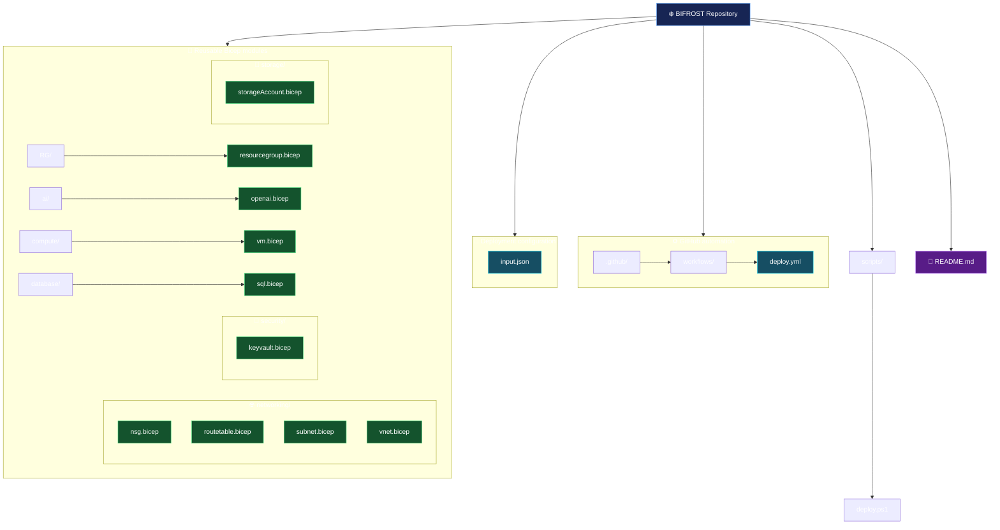
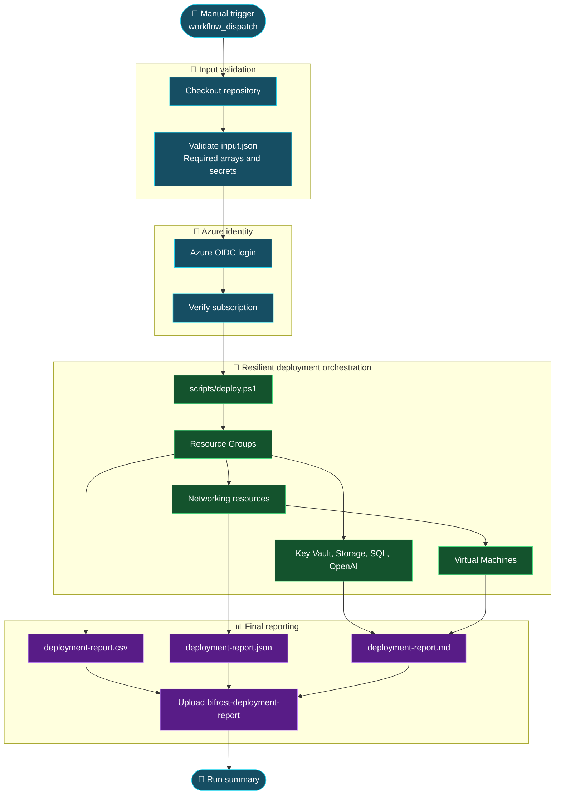
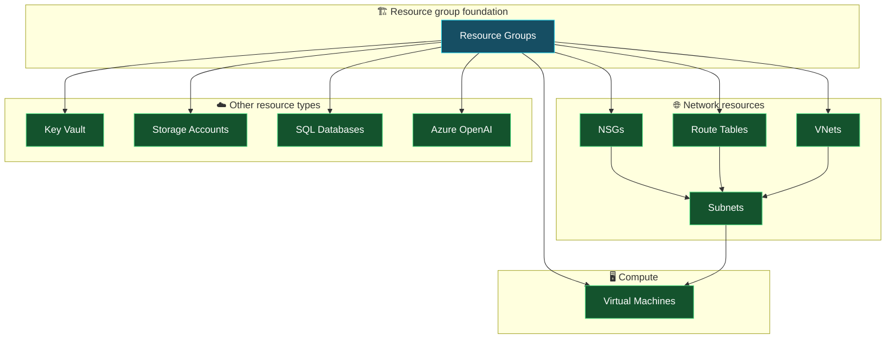

# ❄️ BIFROST — PikeHex Cloud Migration

> **Reusable Azure Bicep modules and GitHub Actions deployment workflow**

BIFROST provisions Azure infrastructure from a JSON configuration file. The repository contains reusable Bicep modules for resource groups, networking, compute, security, storage, databases, and Azure OpenAI.

## 📌 Repository overview

| Area | Description |
|---|---|
| Infrastructure as Code | Modular Azure Bicep templates under `modules/` |
| Deployment input | `input.json` — environment and landing-zone resource configuration |
| CI/CD | `.github/workflows/deploy.yml` — manually triggered GitHub Actions workflow |
| Target environment | `dev` |
| Deployment scope | Subscription scope for resource groups; resource-group scope for the other modules |
| Authentication | Azure login using OpenID Connect (OIDC) |

## 🗂️ Repository structure

The diagram below reflects the files currently present in the `main` branch.



### 📁 Module catalogue

| Module path | Responsibility |
|---|---|
| `modules/RG/resourcegroup.bicep` | Creates resource groups at subscription scope |
| `modules/networking/nsg.bicep` | Creates network security groups and security rules |
| `modules/networking/routetable.bicep` | Creates route tables and routes |
| `modules/networking/vnet.bicep` | Creates virtual networks |
| `modules/networking/subnet.bicep` | Creates subnets and associates NSGs/route tables |
| `modules/compute/vm.bicep` | Creates a Windows VM and its network interface |
| `modules/security/keyvault.bicep` | Creates Azure Key Vault |
| `modules/storage/storageAccount.bicep` | Creates storage accounts, blob service, and containers |
| `modules/database/sql.bicep` | Creates Azure SQL logical servers and databases |
| `modules/ai/openai.bicep` | Creates Azure OpenAI accounts |

## 🔄 CI/CD workflow

The workflow is defined in `.github/workflows/deploy.yml` and is triggered manually using `workflow_dispatch`. It validates `input.json`, authenticates to Azure with OIDC, and invokes `scripts/deploy.ps1` to process requested resources in dependency-aware order.



### 🧭 Deployment dependency and continuation model

Each requested resource is attempted independently when its prerequisites are available. A failure is captured as a resource result and does not terminate the orchestration loop.



### ⚙️ Workflow execution stages

| Stage | Job / script | Runner | Main activity |
|---|---|---|---|
| 1 | `prechecks` | Ubuntu hosted | Validates JSON structure, required arrays, secrets and subscription GUID |
| 2 | `azure-login-check` | Windows self-hosted | Azure OIDC login and subscription verification |
| 3 | `deploy-and-report` | Windows self-hosted | Re-authenticates, invokes the deployment orchestrator, and continues through individual resource failures |
| 4 | Report upload | Same Windows runner | Publishes CSV, JSON and Markdown reports as a workflow artifact |

The deployment job uses `if: always()` so the report stage can run after failed prechecks or Azure authentication. When a global prerequisite fails, every requested resource is recorded as `SKIPPED` with the relevant reason. The deployment runner re-authenticates because Azure login state is not guaranteed to persist between GitHub Actions jobs.

Each resource deployment runs What-If before create. Errors are caught per resource; resources with unavailable prerequisites are marked `SKIPPED`. The workflow's final status is marked failed if any resource failed or was skipped, but only after the report has been uploaded.

## 📊 Fault-tolerant deployment report

The workflow creates a `bifrost-deployment-report` artifact after each run. It contains:

- `deployment-report.csv` — filterable resource-by-resource status report.
- `deployment-report.json` — structured report for automation and downstream processing.
- `deployment-report.md` — readable summary and detailed resource table.

Each requested resource is recorded as one of:

| Status | Meaning |
|---|---|
| `DEPLOYED` | What-If and deployment completed successfully. |
| `FAILED` | The deployment was attempted but Azure/Bicep returned an error. |
| `SKIPPED` | A prerequisite, validation, authentication, or other condition prevented the attempt. The report includes the reason. |

The workflow attempts independent resources even when another resource fails. Subnets require their VNet and any configured NSG/route table; VMs require their resource group, VNet and subnet. Dependent resources are marked `SKIPPED` when prerequisites are unavailable. Resource groups are deployed first; networking and service resources are then attempted in dependency-aware order.

The report is uploaded even when deployment fails. The workflow is marked failed at the end if any resource failed or was skipped, so the run remains visibly unsuccessful without aborting the remaining resource attempts. The artifact is retained for 90 days.

To download it, open the completed GitHub Actions run and download the `bifrost-deployment-report` artifact.

## 📝 Configuration — `input.json`

The root-level `input.json` is the workflow's deployment feed. It currently defines:

- Root environment and request metadata.
- Subscription metadata, with the subscription ID supplied through the `AZURE_SUBSCRIPTION_ID` secret at runtime.
- Deployment location.
- `landingZones` arrays for resource groups, VNets, subnets, NSGs, route tables, VMs, Key Vaults, storage accounts, SQL databases, and Azure OpenAI services.

To request additional instances, add objects to the appropriate array and ensure resource references (for example, VM-to-subnet and subnet-to-NSG/route-table) point to the intended resources.

## 🔐 GitHub Actions secrets and identity

Configure the following secrets for the repository or the `dev` environment:

| Secret | Purpose |
|---|---|
| `AZURE_CLIENT_ID` | Microsoft Entra application/service principal client ID |
| `AZURE_TENANT_ID` | Microsoft Entra tenant ID |
| `AZURE_SUBSCRIPTION_ID` | Azure subscription GUID |
| `VM_ADMIN_PASSWORD` | Windows VM local administrator password |
| `SQL_ADMIN_PASSWORD` | SQL administrator password |

The workflow uses `azure/login@v2` with OIDC. Configure a federated credential in Microsoft Entra ID whose subject matches the GitHub repository/environment context. Do not store credentials or passwords in `input.json` or commit them to the repository.

## 🧰 Local Bicep validation

Run from the repository root after installing Azure CLI and Bicep:

```powershell
$ErrorActionPreference = 'Stop'

az version
az bicep version

$files = Get-ChildItem modules -Recurse -Filter '*.bicep'
if ($files.Count -eq 0) {
    throw 'No Bicep modules found.'
}

foreach ($file in $files) {
    Write-Host "Building $($file.FullName)"
    az bicep build --file $file.FullName --stdout | Out-Null
    if ($LASTEXITCODE -ne 0) {
        throw "Bicep build failed: $($file.FullName)"
    }
}
```

## 🛡️ Deployment safety notes

1. Review the What-If output before approving infrastructure changes.
2. Confirm resource names are valid and globally available where Azure requires uniqueness.
3. Confirm the target subscription, resource groups, region, SKUs, and expected costs.
4. Keep VM and SQL administrator passwords in GitHub Actions secrets.
5. Review network access settings before deployment. The sample configuration includes private SQL network access and a VM without a public IP.
6. Treat changes to existing VNets and subnets carefully; the VNet job intentionally skips an existing VNet to avoid replacing its subnet configuration.

## 📚 Current repository scope

The `main` branch currently contains only the files and folders represented in the repository tree above. In particular, there is no `modules/main.bicep`, `environments/` directory, or `config/subscriptions.json` in this branch. The deployment workflow uses the root `input.json` and invokes the individual Bicep modules directly.

---

<p align="center">
  ❄️ **BIFROST | Infrastructure as Code | Azure | Bicep | GitHub Actions** 🚀
</p>
